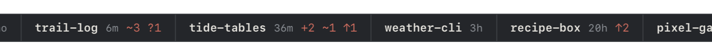

<picture>
  <source media="(prefers-color-scheme: dark)" srcset="docs/logo-dark.svg">
  
</picture>

# gitfeed

A ticker of your GitHub repositories for the Mac: what you touched most recently, and what you
left uncommitted or unpushed.



Each entry shows how long ago the repository was last committed to, followed by the state of
its local checkout in the same shorthand as `git status -s`. It's for the moment you sit down and
can't remember what you were in the middle of.

## Two places to read it

**On the desktop** ([Übersicht](https://tracesof.net/uebersicht/)), a thin strip scrolls above
the Dock, behind your windows. Hover to pause it; click a name to open the repository on GitHub.

**In the menu bar** ([SwiftBar](https://github.com/swiftbar/SwiftBar)), one width-capped line
cycles through your repositories. Click it for the whole list:

```text
trail-log           6m  ~3 ?1
tide-tables        36m  +2 ~1 ↑1
weather-cli         3h
recipe-box         20h  ↑2
pixel-garden        2d
dotfiles            5d  ~1
budget-scripts      1w
───────────────────────────────
✓ Show clean repos in cycle
  Refresh now
```

The menu bar icon is gitfeed's mark: commits running in from the left, ending in an open ring
for the work you haven't committed yet. Click a repository to open it on GitHub, or hold ⌥ and
click to open its local folder in Finder.

Use either one or both. They read the same feed.

## Reading the status

| Glyph | Meaning |
|---|---|
| `+2` | 2 files staged, not committed |
| `~3` | 3 files modified, not staged |
| `?1` | 1 untracked file |
| `↑1` | 1 commit not pushed |
| `↓1` | 1 commit on GitHub you haven't pulled |

No glyph means the checkout is clean, or the repository isn't cloned on this Mac. On the desktop
strip, pending work is the only thing drawn in red.

## Install

You need macOS on Apple Silicon or Intel, [Homebrew](https://brew.sh), and the
[GitHub CLI](https://cli.github.com) signed in. gitfeed runs on the Python 3 that ships with
Apple's Command Line Tools, which you already have if `git` works.

```bash
brew install gh
```

```bash
gh auth login
```

```bash
brew install --cask swiftbar ubersicht
```

```bash
git clone https://github.com/toshon-jennings/gitfeed.git
```

Open SwiftBar and Übersicht once each (SwiftBar asks you to pick a plugin folder), then link
gitfeed into both:

```bash
gitfeed/install.sh
```

To have the ticker back after a restart, add both apps under **System Settings → General →
Login Items**.

## Settings

gitfeed looks for local checkouts in `~/projects` unless you tell it otherwise. Settings live in
`~/.config/gitfeed/config.json`:

```json
{
  "roots": ["~/projects", "~/code"],
  "show_clean": true,
  "max_repos": 40
}
```

| Key | Default | What it does |
|---|---|---|
| `roots` | `["~/projects"]` | Folders whose immediate subfolders are scanned for git checkouts. |
| `show_clean` | `true` | Include clean repositories in the cycle. The menu bar toggle flips this. |
| `max_repos` | `40` | How many clean repositories to show. Ones with pending work always appear. |

You can also flip `show_clean` from a terminal:

```bash
gitfeed/bin/gitfeed toggle-clean
```

## Troubleshooting

**The menu bar item doesn't appear, or clicking it shows nothing.** macOS only places menu bar
icons to the right of the notch, and a new icon goes last, so on a full menu bar gitfeed can end
up off-screen, where macOS won't open its menu. Move it into view by giving it a position near
the right (lower numbers sit further right) and restarting SwiftBar:

```bash
defaults write com.ameba.SwiftBar "NSStatusItem Preferred Position $(cd gitfeed && pwd -P)/swiftbar/gitfeed.1m.py" -float 450
```

```bash
osascript -e 'quit app "SwiftBar"' && open -a SwiftBar
```

If it lands behind the notch, try a smaller number. Something else may get pushed off the
other end instead.

**The desktop strip doesn't appear.** Quit and reopen Übersicht. If your Dock isn't at the
bottom, or is larger than usual, change `bottom:` near the top of
`ubersicht/gitfeed.widget/index.jsx`.

**The ticker says "GitHub unavailable."** Run `gh auth status`. Local checkouts still show while
GitHub is unreachable.

## How it works

`bin/gitfeed` builds a single JSON feed, and both front-ends display it:

- **GitHub:** one GraphQL query through `gh` lists the repositories you own, newest first,
  with each default branch's last commit date. It's cached for 10 minutes.
- **Local:** `git status --porcelain=v2` runs in every checkout under your roots each
  minute. Checkouts are matched to GitHub by their `origin` remote.

Nothing leaves your Mac except that one query to GitHub, made with your own `gh` credentials.
git is run with `core.fsmonitor` and hooks turned off, so scanning a folder can't run programs
named in that checkout's own git config.

| Path | Role |
|---|---|
| `bin/gitfeed` | Builds the feed. Run it alone to see the JSON. |
| `swiftbar/gitfeed.1m.py` | Menu bar plugin; refreshes every minute. |
| `ubersicht/gitfeed.widget/index.jsx` | Desktop ticker. |
| `install.sh` | Links the two front-ends into their apps. Safe to re-run. |
| `docs/logo-*.svg` | The mark: light, dark, and the one-color menu bar version (`swiftbar/icon.png`). |
